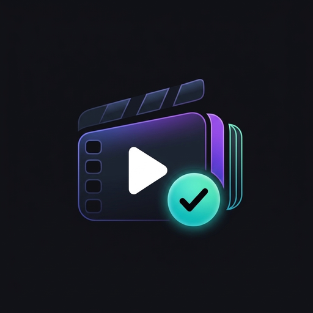

<p align="center">
  
</p>

<h1 align="center">Sequel</h1>

<p align="center">
  <strong>Modern, Offline-First Show & Movie Tracking for Android</strong>
</p>

<p align="center">
  <a href="https://android.com"></a>
  <a href="https://kotlinlang.org"></a>
  <a href="https://developer.android.com/jetpack/compose"></a>
  <a href="https://supabase.com"></a>
  <a href="https://www.themoviedb.org/"></a>
</p>

<p align="center">
  <a href="#key-features">Features</a> &bull;
  <a href="#system-architecture">Architecture</a> &bull;
  <a href="#tech-stack">Tech Stack</a> &bull;
  <a href="#quick-start">Quick Start</a> &bull;
  <a href="#documentation-index">Full Documentation</a> &bull;
  <a href="#license">License</a>
</p>

---

## What is Sequel?

**Sequel** is an elegant, privacy-first Android application designed for film and television enthusiasts. It solves the frustration of spreadsheet tracking, bloated ad-ridden apps, and cloud lock-in by combining an **Offline-First architecture** with opportunistic **Supabase cloud sync** and the vast metadata catalog of **The Movie Database (TMDB)**.

Whether you're offline on a subway commute or managing a watchlist of 5,000+ titles, Sequel guarantees sub-10ms UI responsiveness, zero data loss, and seamless multi-device synchronization.

---

## Key Features

- ⚡ **Offline-First Single Source of Truth**: Powered by Room Database (SQLite v18) with Paging 3. Every read and write is local and instantaneous—the app never blocks on network spinners.
- 🏛️ **Top 4 "Mount Rushmore" Pinned Favorites**: Letterboxd-style showcase pinning your all-time top 4 favorite movies and TV shows to the top of your profile with Roman numeral slots (I–IV), gold border highlights, and seamless search selection.
- 🔄 **Pragmatic Background Sync Engine**: Intelligent WorkManager pipeline (`SyncManager`) featuring `APPEND_OR_REPLACE` concurrency protection, exponential backoff, and Last-Write-Wins (LWW) conflict resolution.
- 🎬 **Comprehensive Media Catalog**: Complete TMDB integration for trending feeds, multi-search, episode air dates, content certifications, cast details, and high-res imagery.
- 📥 **Zero-Lockin Data Importers**: Seamlessly migrate your entire viewing history from **TV Time CSV** and **Trakt CSV/JSON** with background title matching and progress notifications.
- 🎨 **Minimalistic Luxury & Micro-Engineered UI**: Custom interactive 3-chapter onboarding experience with gesture-driven showcase cards, live rating reflections, glowing pill indicators, and haptic feedback. Modern Material 3 dark-purple visual identity (`#A855F7`, `#03DAC6`, `#0F1115`), edge-to-edge Compose architecture, predictive back gestures, and ambient glassmorphic elevations.
- 🔐 **Privacy by Design, Google Sign-In & RLS**: Streamlined Google Sign-In and email authentication with segmented tab switching. No advertising SDKs, no behavioral trackers, and no third-party telemetry. Cloud data is isolated at the PostgreSQL kernel level using Supabase Row-Level Security (RLS).
- 🔗 **Deep-Link Authentication**: Built-in Google OAuth redirects, password reset, and magic link verification handled via custom intent filters (`sequel://login-callback`).

---

## System Architecture

Sequel adheres strictly to **Clean Architecture** and **Unidirectional Data Flow (UDF)** principles:

```
┌─────────────────────────────────────────────────────────────┐
│                    PRESENTATION LAYER                       │
│  Jetpack Compose • Material 3 • Compose Navigation • MVI    │
│  StateFlow ViewModels • Edge-to-Edge • Custom Theming       │
└──────────────────────────────┬──────────────────────────────┘
                               │ Observes UI StateFlow
                               ▼
┌─────────────────────────────────────────────────────────────┐
│                       DOMAIN LAYER                          │
│  Pure Kotlin Business Logic • UseCases (GetNextEpisode)     │
│  Repository Interfaces • AppError Sealed Model • Parsers    │
└──────────────────────────────┬──────────────────────────────┘
                               │ Implemented by
                               ▼
┌─────────────────────────────────────────────────────────────┐
│                        DATA LAYER                           │
│  Repository Implementations • Offline Cache Strategy        │
│                                                             │
│   ┌───────────────────────────┐ ┌─────────────────────────┐ │
│   │    Room SQLite (SSOT)     │ │   WorkManager Workers   │ │
│   │ 9 Entities • v17 Schema   │ │ Watched • Reviews • WL  │ │
│   │ Paging 3 RemoteMediator   │ │ Append-or-Replace Queue │ │
│   └─────────────▲─────────────┘ └────────────┬────────────┘ │
└─────────────────┼────────────────────────────┼──────────────┘
                  │ Cached Reads               │ Asynchronous Sync
                  ▼                            ▼
┌─────────────────────────────────────────────────────────────┐
│                      REMOTE SERVICES                        │
│  TMDB API v3 (Retrofit + OkHttp)  •  Supabase PostgREST/Auth│
└─────────────────────────────────────────────────────────────┘
```

---

## Tech Stack

| Layer | Technologies & Libraries | Technical Rationale |
| :--- | :--- | :--- |
| **UI Framework** | Jetpack Compose + Material 3 BOM | Declarative, reactive UI with dynamic dark theme tokens. |
| **Architecture** | Clean Architecture (Presentation, Domain, Data) | Decoupled business logic from Android framework APIs. |
| **Local Database** | Room SQLite 2.6 (Schema v17) + KSP | Compile-time SQL validation, reactive Flow queries, SSOT. |
| **Paging** | AndroidX Paging 3 + RemoteMediator | Seamless infinite scrolling and memory-efficient caching. |
| **Dependency Injection** | Google Hilt 2.51 + Hilt WorkManager | Modular dependency lifecycle management and worker injection. |
| **Cloud Backend** | Supabase (PostgreSQL 15, PostgREST, GoTrue Auth) | Relational multi-device storage with Row-Level Security. |
| **Catalog API** | TMDB API v3 via Retrofit 2 + OkHttp 4 | Complete media catalog with custom API key interceptor. |
| **Serialization** | Kotlinx Serialization Json | Lightweight, multiplatform reflection-free serialization. |
| **Image Loading** | Coil 3 Compose | Fast, memory-efficient asynchronous image loading and caching. |
| **Background Tasks** | AndroidX WorkManager (Kotlin Coroutines) | Guaranteed task execution with constraints and backoff. |
| **Local Preferences**| Jetpack DataStore Preferences | Thread-safe, transactional replacement for SharedPreferences. |

---

## Quick Start

### 1. Prerequisites
- **JDK 17** (Temurin 17 or Android Studio bundled JDK)
- **Android Studio Ladybug (2024.2.1+)**
- **Android SDK 35** (`minSdk: 26`)

### 2. Clone the Repository
```bash
git clone https://github.com/dev-Aatif/Sequel.git
cd Sequel
```

### 3. Configure API Credentials
Create `local.properties` in the project root:

```properties
sdk.dir=/path/to/your/Android/Sdk

# TMDB API v3 Key (Get from: themoviedb.org/settings/api)
TMDB_API_KEY=your_tmdb_v3_api_key

# Supabase Project Credentials (Create at: supabase.com)
SUPABASE_URL=https://your-project.supabase.co
SUPABASE_ANON_KEY=your_supabase_anon_public_key
```

### 4. Provision Supabase Cloud Database
In your Supabase project dashboard, open the **SQL Editor** and run the complete database creation script found in [docs/DATABASE_SCHEMA.md](docs/DATABASE_SCHEMA.md#5-supabase-cloud-postgresql-schema-ready-to-deploy-ddl).

Next, in **Authentication → URL Configuration**, add the application deep link:
```
sequel://login-callback
```

### 5. Build and Run
```bash
# Assemble and install debug build on connected device/emulator
./gradlew installDebug

# Run unit tests (JVM, Robolectric, Turbine, Room in-memory)
./gradlew testDebugUnitTest

# Run instrumentation tests (Compose UI, Hilt)
./gradlew connectedDebugAndroidTest
```

---

## Release Engineering

Production release builds require `keystore.properties` in the project root:

```properties
KEYSTORE_FILE=../release.keystore
KEYSTORE_PASSWORD=your_keystore_password
KEY_ALIAS=your_key_alias
KEY_PASSWORD=your_key_password
```

> **Automatic Fallback:** If `keystore.properties` is missing, the build automatically falls back to debug signing so CI pipelines and fresh clones never break.

Build production artifacts:
```bash
# Build Google Play App Bundle (.aab)
./gradlew bundleRelease

# Build Standalone Signed APK (.apk)
./gradlew assembleRelease
```
*ProGuard / R8 code obfuscation and resource shrinking are automatically enabled for release variants.*

---

## In-Depth Documentation Index

Explore our comprehensive technical guides:

### Core Architecture & System Specifications
- 📑 [**Product Requirements & Feature Specification**](docs/PRODUCT_SPECIFICATION.md) — Comprehensive PRD, Cine-Swipe discovery, Red Pill rating matrix, personal analytics, and Sequel Pro tiers.
- 📘 [**System Architecture Guide**](docs/ARCHITECTURE.md) — Comprehensive breakdown of layers, state machines, and unidirectional data flow.
- 🔄 [**Offline-First Sync Engine**](docs/SYNC_ENGINE.md) — WorkManager orchestration, `APPEND_OR_REPLACE` policy, and Last-Write-Wins conflict resolution.
- 🗄️ [**Database Architecture & Schema**](docs/DATABASE_SCHEMA.md) — Room v17 schema, migration history (v1→v17), and copy-paste Supabase PostgreSQL DDL.
- 🌐 [**API Integrations & Services**](docs/API_INTEGRATIONS.md) — TMDB API v3 endpoints, image CDN dimensions, Supabase PostgREST & GoTrue auth.
- 📦 [**Data Portability & Import Pipelines**](docs/DATA_PORTABILITY_AND_IMPORTS.md) — TV Time CSV and Trakt export parsers with fuzzy title resolution.

### Operations, Compliance & Governance
- 🛠️ [**Developer Setup & Contributor Guide**](docs/SETUP_AND_CONTRIBUTING.md) — Development environment, coding standards, and PR workflows.
- 🚀 [**Release & Deployment Playbook**](docs/RELEASE_AND_DEPLOYMENT.md) — Automated keystore signing, ProGuard keep rules, and Play Store checklist.
- 🔒 [**Security, Privacy & Data Governance**](docs/SECURITY_AND_PRIVACY.md) — Zero-tracking pledge, Supabase RLS, and GDPR Right to Erasure.
- 📜 [**Privacy Policy Document**](docs/privacy.html) — Official standalone HTML privacy policy.
- 📋 [**Documentation Maintenance Guide**](docs/MAINTENANCE_GUIDE.md) — Change-to-documentation mapping and lifecycle checklist.

### Architecture Decision Records (ADRs)
- 🏛️ [**ADR Index**](docs/decisions/README.md)
  - [ADR-001: Offline-First Architecture with Room as SSOT](docs/decisions/ADR-001-offline-first-room-truth.md)
  - [ADR-002: Supabase as Cloud Backend for Auth and Delta Sync](docs/decisions/ADR-002-supabase-auth-and-delta-sync.md)
  - [ADR-003: TMDB API v3 as Authoritative Media Metadata Provider](docs/decisions/ADR-003-tmdb-metadata-integration.md)
  - [ADR-004: WorkManager with APPEND_OR_REPLACE for Background Sync](docs/decisions/ADR-004-workmanager-background-sync.md)
  - [ADR-005: Schema Separation of Movies from TV Episodes](docs/decisions/ADR-005-separation-of-movies-and-tv-shows.md)

---

## Testing Deep Links Locally

To verify deep link intent handling for authentication callbacks and password reset flows:

```bash
adb shell am start -W -a android.intent.action.VIEW \
  -d "sequel://login-callback#access_token=test_token&refresh_token=test_refresh&type=recovery" \
  dev.sequel.app.debug
```

---

## License

Copyright &copy; 2026 Sequel Project. All rights reserved.
Developed with passion for film, television, and high-performance Android engineering.
