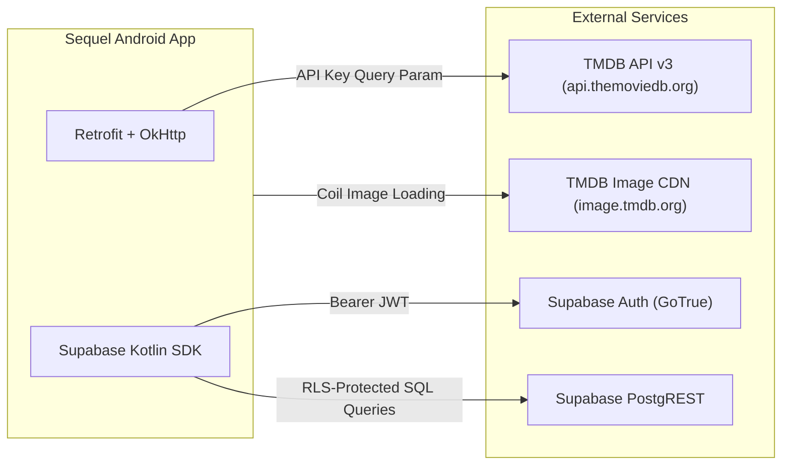

# Sequel — API Integrations & Remote Services Specification

## 1. Overview

Sequel communicates with two primary remote services:
1. **The Movie Database (TMDB) API v3**: Authoritative metadata catalog for movies, TV series, seasons, episodes, imagery, cast/crew, and discovery feeds.
2. **Supabase Cloud Backend**: BaaS (Backend-as-a-Service) providing PostgreSQL database storage via PostgREST, user authentication via GoTrue, and WebSocket real-time updates.



---

## 2. The Movie Database (TMDB) API v3

### 2.1 Authentication & Interceptors
TMDB requires an API key on every request. Rather than hardcoding the key in request annotations, Sequel dynamically injects the key at the network transport layer via `TmdbApiKeyInterceptor`:

```kotlin
class TmdbApiKeyInterceptor(private val apiKey: String) : Interceptor {
    override fun intercept(chain: Interceptor.Chain): Response {
        val original = chain.request()
        val originalHttpUrl = original.url

        val url = originalHttpUrl.newBuilder()
            .addQueryParameter("api_key", apiKey)
            .build()

        val request = original.newBuilder()
            .url(url)
            .build()

        return chain.proceed(request)
    }
}
```

The key is retrieved from `local.properties` (or environment variables in CI) and exposed via `BuildConfig.TMDB_API_KEY`.

---

### 2.2 TMDB Endpoints Reference (`TmdbApiService`)

| Endpoint | Method | Key Parameters | Purpose |
| -------- | ------ | -------------- | ------- |
| `trending/{media_type}/{time_window}` | `GET` | `mediaType`: `tv` \| `movie` \| `all`<br>`timeWindow`: `day` \| `week`<br>`page`: Int | Powers Home screen Trending feeds |
| `search/multi` | `GET` | `query`: String, `page`: Int | Global multi-search across shows and movies |
| `search/tv` | `GET` | `query`: String, `page`: Int | TV-only search filter |
| `search/movie` | `GET` | `query`: String, `page`: Int | Movie-only search filter |
| `tv/{tv_id}` | `GET` | `tvId`: Int<br>`append_to_response`: `content_ratings` | Full series detail, season summaries, certification |
| `tv/{tv_id}/season/{season_number}` | `GET` | `tvId`: Int, `seasonNumber`: Int | Full season details including all episodes |
| `movie/{movie_id}` | `GET` | `movieId`: Int | Movie detail (runtime, budget, release date) |
| `discover/tv` | `GET` | `with_genres`: String?, `sort_by`: String | Genre-specific TV discovery |
| `discover/movie` | `GET` | `with_genres`: String?, `sort_by`: String | Genre-specific movie discovery |

---

### 2.3 Image CDN URL Structure (`TmdbImageUtil`)

TMDB hosts images across multiple pre-computed sizes. Sequel standardizes asset resolution requests through `TmdbImageUtil`:

```
Base CDN URL: https://image.tmdb.org/t/p/{width}{file_path}
```

| Use Case | Asset Type | Width Parameter | Complete Example |
| -------- | ---------- | --------------- | ---------------- |
| Grid Card Poster | Poster | `w500` | `https://image.tmdb.org/t/p/w500/qJ2tW6WMUDux911r6m7haRef0WH.jpg` |
| Small List Thumbnail | Poster | `w185` | `https://image.tmdb.org/t/p/w185/qJ2tW6WMUDux911r6m7haRef0WH.jpg` |
| Screen Hero Header | Backdrop | `w780` / `original` | `https://image.tmdb.org/t/p/w780/hZkgoQYus5vegHoetLkCJzb17zJ.jpg` |
| Episode Still Card | Still | `w300` | `https://image.tmdb.org/t/p/w300/muth4003dke.jpg` |

---

### 2.4 TMDB Rate Limiting & Caching Policy
- **Rate Limit**: Approximately 40 requests per 10-second window.
- **Client Mitigation**:
  - All queried metadata writes to Room immediately.
  - Search queries are debounced by 500ms in ViewModels.
  - Show detail screens serve from Room cache; remote calls are made only on cache miss or pull-to-refresh.

---

## 3. Supabase Cloud Backend Services

### 3.1 Authentication (GoTrue)
Authentication is handled via the `supabase-kt` auth plugin:

#### User Registration & Login:
```kotlin
// Sign in with Email / Password
supabaseClient.auth.signInWith(Email) {
    email = userEmail
    password = userPassword
}

// Sign up
supabaseClient.auth.signUpWith(Email) {
    email = userEmail
    password = userPassword
}
```

#### Session Persistence & Deep Linking:
- The session JWT and refresh token are persisted securely in Android DataStore.
- **Email Verification & Password Recovery** utilize custom URL deep links:
  - In `AndroidManifest.xml`:
    ```xml
    <intent-filter>
        <action android:name="android.intent.action.VIEW" />
        <category android:name="android.intent.category.DEFAULT" />
        <category android:name="android.intent.category.BROWSABLE" />
        <data android:scheme="sequel" android:host="login-callback" />
    </intent-filter>
    ```
  - In `MainActivity.kt`:
    ```kotlin
    override fun onNewIntent(intent: Intent) {
        super.onNewIntent(intent)
        handleIntent(intent)
    }

    private fun handleIntent(intent: Intent?) {
        intent?.let {
            supabaseClient.handleDeeplinks(it)
            val recovery = it.data?.fragment?.contains("type=recovery") == true 
                        || it.data?.getQueryParameter("type") == "recovery"
            if (recovery) {
                isRecovery.value = true
            }
        }
    }
    ```

---

### 3.2 PostgREST Database API (`SupabaseSyncService`)

All remote database requests are executed against PostgREST RESTful endpoints.

#### Upsert Semantics with Conflict Targets:
To support idempotent synchronization without duplicate key errors, upsert operations specify unique conflict targets:

```kotlin
// Watched Movies Upsert
val result = supabaseClient.postgrest["watched_movies"]
    .upsert(dto) {
        onConflict = "user_id,tmdb_movie_id"
        select(Columns.list("id"))
    }
    .decodeSingle<SupabaseWatchedMovieDto>()

// Watched Episodes Batch Upsert
val results = supabaseClient.postgrest["watched_episodes"]
    .upsert(dtos) {
        onConflict = "user_id,show_id,season_number,episode_number"
        select()
    }
    .decodeList<SupabaseWatchedEpisodeDto>()
```

#### Chunked Range Queries (Delta Pull):
When pulling records from Supabase, queries are bounded using `range(offset, offset + limit - 1)`:
```kotlin
val chunk = supabaseClient.postgrest["user_watchlist"]
    .select {
        filter { eq("user_id", userId) }
        range(offset, offset + limit - 1)
    }.decodeList<SupabaseWatchlistDto>()
```

---

## 4. Error Mapping & Translation Matrix

Remote exceptions are transformed into domain `AppError` types:

| Remote Exception / Status | Root Cause | Mapped AppError | User Experience Impact |
| ------------------------- | ---------- | --------------- | ---------------------- |
| `java.net.UnknownHostException` | Device offline | `AppError.NoInternet` | Local cache used; non-intrusive offline indicator |
| `java.net.SocketTimeoutException` | Slow cellular network | `AppError.Timeout` | Retry action presented |
| `RestException (invalid_credentials)` | Wrong email/password | `AppError.InvalidCredentials` | Form highlights input error |
| `RestException (rate_limit)` | Supabase rate limit | `AppError.Validation` | Prompt user to wait |
| `HttpException (401 / 403)` | Expired JWT / bad token | `AppError.SessionExpired` | Prompts re-login |
| `HttpException (404)` | TMDB ID not found | `AppError.NotFound` | Shows empty state with search suggestion |
| `HttpException (500..599)` | TMDB / Supabase server error | `AppError.ServerError` | Displays retry banner; keeps local data intact |
