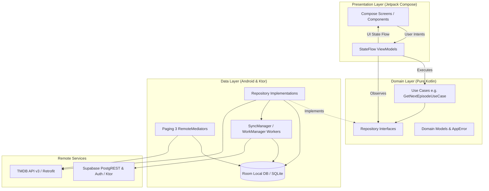
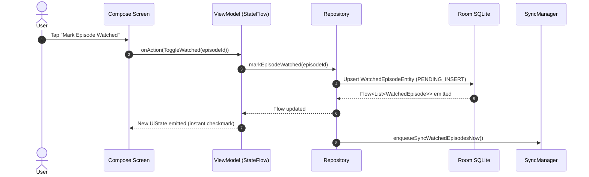

# Sequel — System Architecture Guide

## 1. Architectural Philosophy

Sequel is architected around three foundational engineering principles:
1. **Offline-First Resilience**: Local storage (Room/SQLite) is the **Single Source of Truth (SSOT)**. The user interface *never* suspends awaiting a remote network request to render local data.
2. **Unidirectional Data Flow (UDF)**: State flows down from ViewModels to Jetpack Compose UI hierarchies; user intents and events bubble up.
3. **Clean Architecture Separation of Concerns**: Strict boundaries between Presentation, Domain, Data, and Remote layers ensure maintainability, testability, and decoupled refactoring.



---

## 2. Layered Architecture Breakdown

### 2.1 Presentation Layer (`dev.sequel.app.presentation`)
Built entirely with **Jetpack Compose** and **Material 3**, utilizing modern declarative UI paradigms:
- **Navigation Graph (`SequelNavGraph.kt`)**: Declarative route definitions via sealed class `Screen`. Implements animated slide/fade transitions and deep-link routing for authentication recovery.
- **Scaffold & Shell (`MainScaffold.kt`)**: Implements edge-to-edge window insets, bottom navigation bar visibility toggling depending on active routes, and global snackbar / error handling.
- **ViewModels (`*ViewModel.kt`)**: Powered by `androidx.lifecycle.ViewModel` and Kotlin Coroutines `StateFlow`. Emits immutable UI state objects (e.g., `DetailUiState`, `HomeUiState`).
- **Design System & Theme (`presentation/theme`)**: Custom color tokens (`SequelAccent #A855F7`, `SequelSecondary #03DAC6`, `SequelSurface #1A1D24`, `SequelBackground #0F1115`) providing a sleek dark-mode aesthetic with ambient glows and glassmorphic elevations.

#### Unidirectional State Flow in Compose


---

### 2.2 Domain Layer (`dev.sequel.app.domain`)
Pure Kotlin layer with zero Android framework dependencies (except system Uri abstractions where necessary for file imports):
- **Repository Contracts (`domain/repository`)**: Interfaces defining data access (`ShowRepository`, `SeasonRepository`, `WatchedEpisodeRepository`, `WatchlistRepository`, `AuthRepository`).
- **Use Cases (`domain/usecase`)**: Encapsulates complex reusable business logic spanning multiple repositories. For example, `GetNextEpisodeUseCase` determines the chronological "Up Next" episode by evaluating watched history, skipped status, season numbering, and air dates.
- **Domain Errors (`domain/error/AppError.kt`)**: Sealed hierarchy mapping low-level network, HTTP, SQLite, and Supabase exceptions into user-friendly domain types (`NoInternet`, `Timeout`, `AuthFailed`, `NotFound`, `InvalidCredentials`, `Validation`).
- **Data Importers (`domain/importer`)**: Parsing engines for TV Time CSV and Trakt JSON/CSV formats with fuzzy title matching.

---

### 2.3 Data Layer (`dev.sequel.app.data`)
Responsible for data persistence, network communication, paging, and synchronization:
- **Local Storage (`data/local`)**: Room Database (currently Schema v17) containing DAOs, SQLite entities, and custom `TypeConverters`.
- **Remote Services (`data/remote`)**:
  - `tmdb/`: Retrofit REST client for TMDB API v3, injecting API keys via `TmdbApiKeyInterceptor`.
  - `supabase/`: `SupabaseClient` with Ktor engine for PostgREST database CRUD, Realtime WebSocket streams, and GoTrue Auth sessions.
- **Paging 3 Integration (`data/paging`)**: `TrendingRemoteMediator` coordinates with TMDB paged responses and local `trending_shows` / `remote_keys` tables to provide infinite scrolling with zero flicker.
- **Sync Subsystem (`data/sync`)**: `SyncManager` coordinates WorkManager workers (`SyncWatchedWorker`, `SyncReviewsWorker`, `SyncWatchlistWorker`, `SyncPullWorker`, `AirDateWorker`) to sync local mutations with Supabase.

---

### 2.4 Dependency Injection (`dev.sequel.app.di`)
Configured using **Google Hilt**:
- `AppModule`: Provides application context, Coroutine dispatchers (`Dispatchers.IO`, `Dispatchers.Default`), and shared preferences / DataStore.
- `DatabaseModule`: Provides single-instance `SequelDatabase` with registered migration strategies (`MIGRATION_7_8` through `MIGRATION_16_17`) and all Room DAOs.
- `NetworkModule`: Configures OkHttp with logging interceptors, Retrofit with `kotlinx.serialization.converter`, and `TmdbApiService`.
- `SupabaseModule`: Instantiates and configures the unified `SupabaseClient` with Auth, Postgrest, and Realtime plugins.
- `WorkerModule`: Configures Hilt WorkManager integration (`@HiltWorkerFactory`) enabling constructor injection in background workers.

---

## 3. Core Data Flow Patterns

### 3.1 Screen Data Hydration (Read Path)
1. Screen opens (e.g., `ShowDetailScreen`).
2. ViewModel requests a Room `Flow<ShowWithSeasons>` from `ShowRepository`.
3. Cached data renders instantly on screen (zero millisecond loading time if cached).
4. Simultaneously, repository evaluates cache freshness or triggers an asynchronous refresh from TMDB if data is missing or stale.
5. Fresh TMDB data writes to Room; the Room `Flow` emits the updated record automatically; UI updates gracefully without full-screen spinners.

### 3.2 User Interaction & Mutation (Write Path)
1. User marks an episode watched.
2. The UI invokes `viewModel.toggleEpisodeWatched(showId, seasonNum, episodeNum)`.
3. The repository writes an entity to Room with `sync_status = "PENDING_INSERT"`.
4. Room triggers immediate Flow emission; UI reflects watched state instantaneously.
5. The repository notifies `SyncManager.syncWatchedEpisodesNow()`.
6. WorkManager executes `SyncWatchedWorker` over network:
   - Queries Room for rows where `sync_status != "SYNCED"`.
   - Sends batch upsert payload to Supabase PostgREST table `watched_episodes`.
   - On HTTP 200/201 response, updates local Room rows to `sync_status = "SYNCED"` and records Supabase UUID.
   - On network failure, WorkManager schedules exponential retry while local data remains completely intact.

---

## 4. Error Handling Strategy

Errors are intercepted at the boundary of the Data layer and mapped into the sealed `AppError` domain hierarchy via the extension function `Throwable.toAppError()`:

```kotlin
fun Throwable.toAppError(): AppError = when (this) {
    is UnknownHostException, is ConnectException, is IOException -> AppError.NoInternet
    is SocketTimeoutException -> AppError.Timeout
    is RestException -> when {
        error.contains("invalid_credentials") -> AppError.InvalidCredentials()
        error.contains("rate_limit") -> AppError.Validation("Too many attempts.")
        else -> AppError.Unknown(message)
    }
    is HttpException -> when (code()) {
        401 -> AppError.AuthFailed
        403 -> AppError.SessionExpired
        404 -> AppError.NotFound
        in 500..599 -> AppError.ServerError
        else -> AppError.Unknown("Unexpected network error")
    }
    else -> AppError.Unknown(localizedMessage ?: "Unknown error")
}
```

ViewModels expose error channels or include error state in UI data classes, allowing Composables to present non-intrusive snackbars, banner warnings, or retry action buttons without crashing.

---

## 5. Architectural Quality Attributes

| Attribute | Implementation Mechanism | Target Benchmark |
| --------- | ------------------------ | ---------------- |
| **Cold Start Performance** | App Startup library + Room eager DAO caching | < 600ms on mid-tier hardware |
| **Offline Reliability** | Room as SSOT + WorkManager retry queue | 100% offline feature retention for tracked items |
| **Battery Efficiency** | WorkManager network constraints (`NetworkType.CONNECTED`) | Zero background wakeups when offline |
| **Thread Safety** | Room query dispatchers + Mutex locks on batch sync | Zero SQLite database locks / ANRs |
| **Data Integrity** | Foreign Key cascading + Unique composite indexes | Zero orphan records across seasons/episodes |
