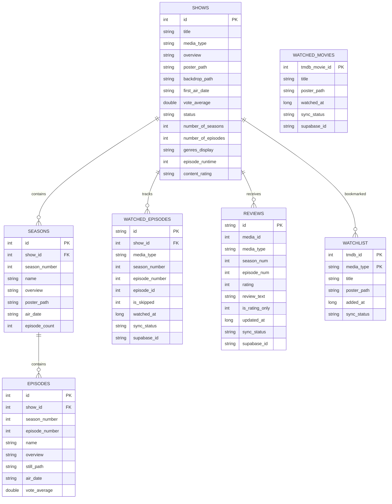

# Sequel — Database Architecture & Schema Specification

## 1. Overview

Sequel employs a dual-database architecture:
1. **Local Database**: **Room Database (SQLite)** embedded in the Android client (current version: **v17**). It acts as the authoritative single source of truth for all UI reads.
2. **Cloud Database**: **Supabase (PostgreSQL 15+)** providing multi-device cloud persistence, authentication identity, and Row-Level Security (RLS).

---

## 2. Entity-Relationship (ER) Diagram



---

## 3. Local Room SQLite Schema (Version 17)

### 3.1 `shows` Table
Caches core show and movie metadata returned by TMDB.

```sql
CREATE TABLE IF NOT EXISTS `shows` (
    `id` INTEGER NOT NULL,
    `title` TEXT NOT NULL,
    `overview` TEXT NOT NULL,
    `poster_path` TEXT,
    `backdrop_path` TEXT,
    `first_air_date` TEXT,
    `vote_average` REAL NOT NULL,
    `vote_count` INTEGER NOT NULL,
    `popularity` REAL NOT NULL,
    `genres` TEXT NOT NULL,
    `status` TEXT,
    `media_type` TEXT NOT NULL,
    `number_of_seasons` INTEGER NOT NULL,
    `number_of_episodes` INTEGER NOT NULL,
    `genres_display` TEXT DEFAULT NULL,
    `episode_runtime` INTEGER DEFAULT NULL,
    `content_rating` TEXT DEFAULT NULL,
    PRIMARY KEY(`id`)
);
CREATE INDEX IF NOT EXISTS `index_shows_media_type` ON `shows` (`media_type`);
```

---

### 3.2 `seasons` Table
Caches season metadata with cascading foreign keys to `shows`.

```sql
CREATE TABLE IF NOT EXISTS `seasons` (
    `id` INTEGER NOT NULL,
    `show_id` INTEGER NOT NULL,
    `season_number` INTEGER NOT NULL,
    `name` TEXT NOT NULL,
    `overview` TEXT NOT NULL,
    `poster_path` TEXT,
    `air_date` TEXT,
    `episode_count` INTEGER NOT NULL,
    PRIMARY KEY(`id`),
    FOREIGN KEY(`show_id`) REFERENCES `shows`(`id`) ON DELETE CASCADE
);
CREATE INDEX IF NOT EXISTS `index_seasons_show_id` ON `seasons` (`show_id`);
```

---

### 3.3 `episodes` Table
Caches individual episode metadata with cascading foreign keys to `shows`.

```sql
CREATE TABLE IF NOT EXISTS `episodes` (
    `id` INTEGER NOT NULL,
    `show_id` INTEGER NOT NULL,
    `season_number` INTEGER NOT NULL,
    `episode_number` INTEGER NOT NULL,
    `name` TEXT NOT NULL,
    `overview` TEXT NOT NULL,
    `still_path` TEXT,
    `air_date` TEXT,
    `vote_average` REAL NOT NULL,
    PRIMARY KEY(`id`),
    FOREIGN KEY(`show_id`) REFERENCES `shows`(`id`) ON DELETE CASCADE
);
CREATE INDEX IF NOT EXISTS `index_episodes_show_id` ON `episodes` (`show_id`);
CREATE INDEX IF NOT EXISTS `index_episodes_show_id_season_number` ON `episodes` (`show_id`, `season_number`);
```

---

### 3.4 `watched_episodes` Table
Stores watched status for TV series episodes.

```sql
CREATE TABLE IF NOT EXISTS `watched_episodes` (
    `id` TEXT NOT NULL,
    `show_id` INTEGER NOT NULL,
    `media_type` TEXT NOT NULL,
    `season_number` INTEGER NOT NULL,
    `episode_number` INTEGER NOT NULL,
    `episode_id` INTEGER NOT NULL,
    `is_skipped` INTEGER NOT NULL DEFAULT 0,
    `watched_at` INTEGER NOT NULL,
    `sync_status` TEXT NOT NULL,
    `supabase_id` TEXT,
    PRIMARY KEY(`id`)
);
CREATE UNIQUE INDEX IF NOT EXISTS `index_watched_episodes_show_id_media_type_season_number_episode_number` 
ON `watched_episodes` (`show_id`, `media_type`, `season_number`, `episode_number`);
CREATE INDEX IF NOT EXISTS `index_watched_episodes_sync_status` ON `watched_episodes` (`sync_status`);
```

---

### 3.5 `watched_movies` Table
Stores watched status specifically for movies (segregated from TV in Migration 15→16).

```sql
CREATE TABLE IF NOT EXISTS `watched_movies` (
    `tmdb_movie_id` INTEGER NOT NULL,
    `title` TEXT NOT NULL,
    `poster_path` TEXT,
    `watched_at` INTEGER NOT NULL,
    `sync_status` TEXT NOT NULL,
    `supabase_id` TEXT,
    PRIMARY KEY(`tmdb_movie_id`)
);
CREATE INDEX IF NOT EXISTS `index_watched_movies_sync_status` ON `watched_movies` (`sync_status`);
```

---

### 3.6 `watchlist` Table
Stores user bookmarked shows and movies.

```sql
CREATE TABLE IF NOT EXISTS `watchlist` (
    `tmdb_id` INTEGER NOT NULL,
    `media_type` TEXT NOT NULL,
    `title` TEXT NOT NULL,
    `poster_path` TEXT,
    `added_at` INTEGER NOT NULL,
    `sync_status` TEXT NOT NULL,
    PRIMARY KEY(`tmdb_id`, `media_type`)
);
CREATE INDEX IF NOT EXISTS `index_watchlist_sync_status` ON `watchlist` (`sync_status`);
```

---

### 3.7 `reviews` Table
Stores user ratings (1-10) and markdown review text.

```sql
CREATE TABLE IF NOT EXISTS `reviews` (
    `id` TEXT NOT NULL,
    `media_id` INTEGER NOT NULL,
    `media_type` TEXT NOT NULL,
    `season_num` INTEGER,
    `episode_num` INTEGER,
    `rating` INTEGER DEFAULT NULL,
    `review_text` TEXT,
    `is_rating_only` INTEGER NOT NULL DEFAULT 0,
    `updated_at` INTEGER NOT NULL,
    `sync_status` TEXT NOT NULL,
    `supabase_id` TEXT,
    PRIMARY KEY(`id`)
);
CREATE INDEX IF NOT EXISTS `index_reviews_media_id_media_type` ON `reviews` (`media_id`, `media_type`);
-- Partial unique index preventing duplicate movie reviews
CREATE UNIQUE INDEX IF NOT EXISTS `idx_reviews_movie_unique` 
ON `reviews` (`media_id`, `media_type`) 
WHERE season_num IS NULL AND episode_num IS NULL;
```

---

### 3.8 `trending_shows` Table
Caches paginated trending lists preserving order.

```sql
CREATE TABLE IF NOT EXISTS `trending_shows` (
    `showId` INTEGER NOT NULL,
    `mediaType` TEXT NOT NULL,
    `page` INTEGER NOT NULL,
    `position` INTEGER NOT NULL,
    PRIMARY KEY(`showId`)
);
```

---

### 3.9 `remote_keys` Table
Coordinates Paging 3 `RemoteMediator` cursor keys.

```sql
CREATE TABLE IF NOT EXISTS `remote_keys` (
    `showId` INTEGER NOT NULL,
    `mediaType` TEXT NOT NULL,
    `prevKey` INTEGER,
    `nextKey` INTEGER,
    PRIMARY KEY(`showId`, `mediaType`)
);
```

---

## 4. Room Database Migration History

| Migration | Version Transition | Changes & Technical Rationale |
| --------- | ------------------ | ----------------------------- |
| `MIGRATION_7_8` | 7 → 8 | Replaced legacy `vibe_emoji` column with numerical `rating` (Integer 1..10) in `reviews`. |
| `MIGRATION_8_9` | 8 → 9 | Added metadata columns: `genres_display`, `episode_runtime`, and `content_rating` to `shows`. |
| `MIGRATION_9_10` | 9 → 10 | Created `trending_shows` table to preserve home feed ordering without overwriting show entity data. |
| `MIGRATION_10_11` | 10 → 11 | Added `mediaType` to `remote_keys` primary key to avoid TV/Movie ID collisions during Paging 3 fetches. |
| `MIGRATION_11_12` | 11 → 12 | Added `is_skipped` (Integer default 0) to `watched_episodes` for smart "Up Next" calculations. |
| `MIGRATION_12_13` | 12 → 13 | Recreated `watchlist` table with composite primary key `(tmdb_id, media_type)`. |
| `MIGRATION_13_14` | 13 → 14 | Upgraded `watched_episodes` unique index to `(show_id, media_type, season_number, episode_number)`. |
| `MIGRATION_14_15` | 14 → 15 | Overhauled `reviews` schema; added `is_rating_only` and relaxed constraint to allow multi-episode reviews. |
| `MIGRATION_15_16` | 15 → 16 | Segregated movies into dedicated `watched_movies` table; cleanly separated TV episode data. |
| `MIGRATION_16_17` | 16 → 17 | Added partial unique index `idx_reviews_movie_unique` preventing ghost duplicate movie reviews. |

---

## 5. Supabase Cloud PostgreSQL Schema (Ready-to-Deploy DDL)

To provision a fresh Supabase instance for Sequel, execute the following SQL script in the **Supabase SQL Editor**:

```sql
-- ── 1. Enable UUID Extension ──────────────────────────────────────
CREATE EXTENSION IF NOT EXISTS "uuid-ossp";

-- ── 2. User Watchlist Table ───────────────────────────────────────
CREATE TABLE IF NOT EXISTS public.user_watchlist (
    id UUID PRIMARY KEY DEFAULT uuid_generate_v4(),
    user_id UUID NOT NULL REFERENCES auth.users(id) ON DELETE CASCADE,
    tmdb_id INTEGER NOT NULL,
    media_type TEXT NOT NULL CHECK (media_type IN ('tv', 'movie')),
    title TEXT NOT NULL,
    poster_path TEXT,
    added_at BIGINT NOT NULL,
    created_at TIMESTAMP WITH TIME ZONE DEFAULT NOW(),
    CONSTRAINT user_watchlist_unique UNIQUE (user_id, tmdb_id, media_type)
);

-- Enable RLS & Policies
ALTER TABLE public.user_watchlist ENABLE ROW LEVEL SECURITY;

CREATE POLICY "Users can manage their own watchlist"
ON public.user_watchlist
FOR ALL
USING (auth.uid() = user_id)
WITH CHECK (auth.uid() = user_id);

CREATE INDEX IF NOT EXISTS idx_watchlist_user_id ON public.user_watchlist(user_id);

-- ── 3. Watched Movies Table ───────────────────────────────────────
CREATE TABLE IF NOT EXISTS public.watched_movies (
    id UUID PRIMARY KEY DEFAULT uuid_generate_v4(),
    user_id UUID NOT NULL REFERENCES auth.users(id) ON DELETE CASCADE,
    tmdb_movie_id INTEGER NOT NULL,
    title TEXT NOT NULL,
    poster_path TEXT,
    watched_at BIGINT NOT NULL,
    created_at TIMESTAMP WITH TIME ZONE DEFAULT NOW(),
    CONSTRAINT watched_movies_user_tmdb_unique UNIQUE (user_id, tmdb_movie_id)
);

ALTER TABLE public.watched_movies ENABLE ROW LEVEL SECURITY;

CREATE POLICY "Users can manage their watched movies"
ON public.watched_movies
FOR ALL
USING (auth.uid() = user_id)
WITH CHECK (auth.uid() = user_id);

CREATE INDEX IF NOT EXISTS idx_watched_movies_user ON public.watched_movies(user_id);

-- ── 4. Watched Episodes Table ─────────────────────────────────────
CREATE TABLE IF NOT EXISTS public.watched_episodes (
    id UUID PRIMARY KEY DEFAULT uuid_generate_v4(),
    user_id UUID NOT NULL REFERENCES auth.users(id) ON DELETE CASCADE,
    tmdb_show_id INTEGER NOT NULL,
    tmdb_episode_id INTEGER NOT NULL,
    season_number INTEGER NOT NULL,
    episode_number INTEGER NOT NULL,
    is_skipped BOOLEAN NOT NULL DEFAULT FALSE,
    watched_at BIGINT NOT NULL,
    created_at TIMESTAMP WITH TIME ZONE DEFAULT NOW(),
    CONSTRAINT watched_episodes_unique UNIQUE (user_id, tmdb_episode_id)
);

ALTER TABLE public.watched_episodes ENABLE ROW LEVEL SECURITY;

CREATE POLICY "Users can manage their watched episodes"
ON public.watched_episodes
FOR ALL
USING (auth.uid() = user_id)
WITH CHECK (auth.uid() = user_id);

CREATE INDEX IF NOT EXISTS idx_watched_episodes_user_show ON public.watched_episodes(user_id, tmdb_show_id);

-- ── 5. Reviews Table ──────────────────────────────────────────────
CREATE TABLE IF NOT EXISTS public.reviews (
    id UUID PRIMARY KEY DEFAULT uuid_generate_v4(),
    user_id UUID NOT NULL REFERENCES auth.users(id) ON DELETE CASCADE,
    media_id INTEGER NOT NULL,
    media_type TEXT NOT NULL CHECK (media_type IN ('tv', 'movie')),
    season_num INTEGER,
    episode_num INTEGER,
    rating INTEGER CHECK (rating >= 1 AND rating <= 10),
    review_text TEXT,
    is_rating_only BOOLEAN NOT NULL DEFAULT FALSE,
    updated_at BIGINT NOT NULL,
    created_at TIMESTAMP WITH TIME ZONE DEFAULT NOW()
);

-- Partial unique index for movies (where season and episode are null)
CREATE UNIQUE INDEX IF NOT EXISTS idx_remote_reviews_movie_unique 
ON public.reviews (user_id, media_id, media_type) 
WHERE season_num IS NULL AND episode_num IS NULL;

ALTER TABLE public.reviews ENABLE ROW LEVEL SECURITY;

CREATE POLICY "Users can manage their reviews"
ON public.reviews
FOR ALL
USING (auth.uid() = user_id)
WITH CHECK (auth.uid() = user_id);

CREATE INDEX IF NOT EXISTS idx_reviews_user_media ON public.reviews(user_id, media_id);

-- ── 6. Account Deletion Function (Mandatory for Google Play) ─────
-- Allows authenticated users to safely trigger their own account deletion via RPC
CREATE OR REPLACE FUNCTION delete_user()
RETURNS void
LANGUAGE plpgsql
SECURITY DEFINER
AS $$
BEGIN
    DELETE FROM auth.users WHERE id = auth.uid();
END;
$$;

GRANT EXECUTE ON FUNCTION delete_user() TO authenticated;
```

