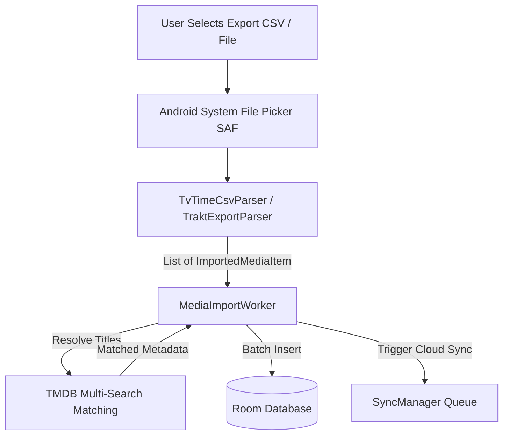

# Sequel — Data Portability & Import Pipelines

## 1. Overview

Users transitioning from legacy or discontinued media tracking services (such as **TV Time** or **Trakt**) can seamlessly import their entire history into Sequel without losing viewing dates, ratings, or season progress.

The data portability subsystem consists of:
- **`MediaDataParser` Interface**: Contract for streaming CSV/JSON export files into normalized `ImportedMediaItem` objects.
- **`TvTimeCsvParser`**: Dedicated parser for TV Time account export archives.
- **`TraktExportParser`**: Dedicated parser for Trakt CSV/JSON backup exports.
- **`MediaImportWorker`**: Background WorkManager process that matches titles against TMDB, writes to Room, and updates notification progress.



---

## 2. Supported Export Formats & Grammar

### 2.1 TV Time CSV Export (`TvTimeCsvParser`)
TV Time provides user data exports containing watched episode and movie records.

#### Recognized Column Headers:
- **Title / Show Name**: `tv_show_name`, `movie_name`, `title`, or any column containing `name`.
- **Season Number**: `episode_season_number`, `season`.
- **Episode Number**: `episode_number`, `episode`.
- **Date Watched**: `created_at`, `updated_at`, `date`. Formatted as `yyyy-MM-dd HH:mm:ss`.

#### Sample TV Time CSV Snippet:
```csv
tv_show_name,episode_season_number,episode_number,created_at
"Breaking Bad",1,1,"2021-04-12 20:30:00"
"Breaking Bad",1,2,"2021-04-12 21:25:00"
"Inception",,,"2022-01-15 18:00:00"
```

#### Media Type Detection Logic:
If both `season_number` and `episode_number` are missing or null, the row is classified as `movie`; otherwise, it is classified as `tv`.

---

### 2.2 Trakt Export (`TraktExportParser`)
Trakt exports history in structured CSV format.

#### Recognized Column Headers:
- `Title`: Media title string.
- `Year`: Release year (used to disambiguate reboots/remakes).
- `Season`: Season index.
- `Episode`: Episode index.
- `Type`: Literal string (`show`, `episode`, `movie`).

#### Sample Trakt CSV Snippet:
```csv
Title,Year,Season,Episode,Type
"Severance",2022,1,1,"episode"
"Severance",2022,1,2,"episode"
"Dune: Part Two",2024,,,"movie"
```

---

## 3. Background Processing (`MediaImportWorker`)

Because imports can contain **3,000–10,000 records**, processing cannot run on the UI thread or within ephemeral ViewModel lifecycles. `MediaImportWorker` runs in the background using Android Jetpack WorkManager:

### 3.1 Pipeline Stages:
1. **Streaming Parse**: The file is read via `ContentResolver.openInputStream(uri)` line-by-line to avoid loading massive multi-megabyte CSV files entirely into memory.
2. **Title Disambiguation**: For each distinct show or movie, the worker searches TMDB. If a release year is present (from Trakt), it ranks matches matching the year highest.
3. **Episode Hierarchy Hydration**: For TV series, season and episode metadata is fetched from TMDB and stored in `shows`, `seasons`, and `episodes` tables.
4. **Batch Room Persistence**: Watched rows are inserted into `watched_episodes` and `watched_movies` in batches of 250 using `insertAll()`.
5. **Foreground Notification Progress**: Displays a live progress bar notification (`Importing: 1,240 / 3,500 items...`).
6. **Cloud Sync Dispatch**: Upon completion, `SyncManager.syncWatchedEpisodesNow()` is triggered to synchronize the newly imported library with Supabase.

---

## 4. User Import Guide

1. **Obtain Your Export**:
   - **TV Time**: Open TV Time app → *Settings* → *Account* → *Request my data*. Download the resulting `.csv` from your email.
   - **Trakt**: Open Trakt.tv → *Settings* → *Data* → *Export History*.
2. **In Sequel**:
   - Navigate to **Profile** → **Settings** (Gear icon) → **Import Media Data**.
   - Select either **TV Time CSV** or **Trakt CSV**.
   - Choose the file using the Android system file selector.
   - Sequel will display an estimated import count and begin processing in the background. You can safely exit the app while the import completes.
