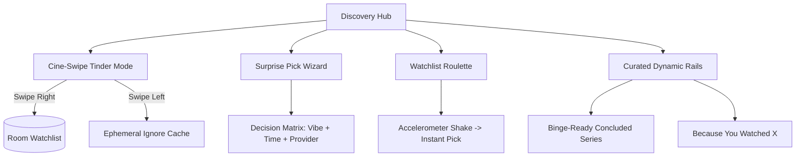
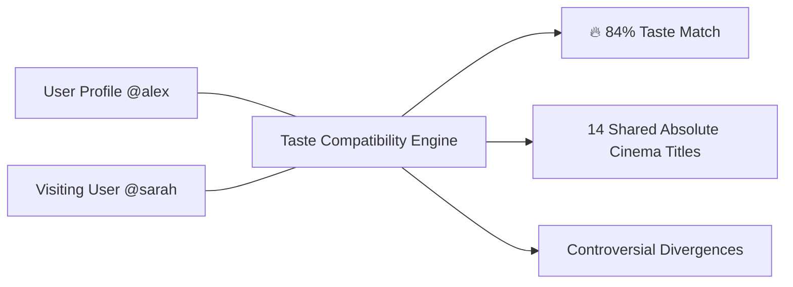
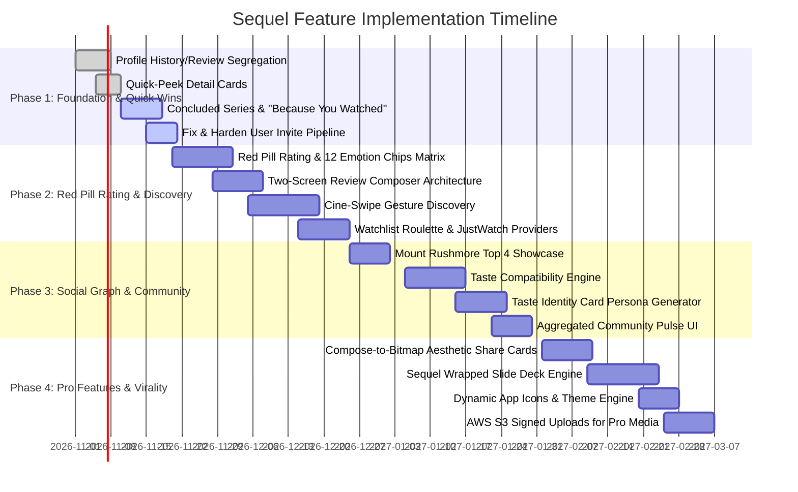

# Sequel — Product Requirements & Feature Specification (PRD)

> **Document Version:** 2.0.0  
> **Target Platform:** Android 8.0+ (API 26–35)  
> **Architecture:** Jetpack Compose (M3) • Offline-First Room SQLite (v17+) • Supabase BaaS • TMDB API v3  
> **Status:** Approved for Implementation  

---

## 1. Executive Summary & Product Vision

### 1.1 The Problem
Existing media tracking platforms (Letterboxd, Trakt, IMDb, TV Time) suffer from three fatal flaws:
1. **Spreadsheet Fatigue & Clutter:** Over-indexing on tedious per-episode grading turns entertainment into database homework.
2. **Generic, Sterile Scoring:** A flat "7.2/10" star rating fails to capture the emotional reality of cinema—whether a film was a transcendent psychological puzzle, a comfort watch, or pretentious slop.
3. **Sluggish, Ad-Bloated Cloud Locks:** Constant network spinners on slow mobile connections, privacy-invasive ad SDKs, and locked-in data silos.

### 1.2 The Sequel Solution
**Sequel** is an elegant, privacy-first, cult cinephile ecosystem engineered for Android. It unites an **Offline-First Room architecture** with a distinct counter-cultural identity:
- **The "Red Pill" Rating Paradigm:** Transcending stars with a calibrated 1.0–10.0 Red Pill scale and a 12-vector emotional taxonomy.
- **Serendipitous Discovery:** Tinder-style gesture swiping (*Cine-Swipe*), Watchlist Roulette, and curated binge rails.
- **Social Without Slop:** Algorithmic taste compatibility scores, Letterboxd-style Mount Rushmore showcases, and cultured community reactions.
- **Deep Cine-Analytics & Wrapped:** Spotify Wrapped-style cinematic recaps and interactive genre fingerprints.

```
┌─────────────────────────────────────────────────────────────────────────────┐
│                          SEQUEL PRODUCT ECOSYSTEM                           │
├───────────────────────┬─────────────────────────────┬───────────────────────┤
│  DISCOVERY & FEED     │     RATING & REVIEW         │  ANALYTICS & IDENTITY │
│  • Cine-Swipe Mode    │  • 1.0–10.0 Red Pills Scale │  • Genre Fingerprint  │
│  • Watchlist Roulette │  • 12 Emotion Chips Matrix  │  • Taste Compatibility│
│  • Concluded Rails    │  • Ranked Cultural Emojis   │  • Taste Identity Card│
│  • Stream Providers   │  • Per-Season Granularity   │  • Sequel Wrapped     │
└───────────────────────┴─────────────────────────────┴───────────────────────┘
```

---

## 2. Core Architectural Principles & Scope Boundaries

### 2.1 Scope Boundary: Per-Movie & Per-Season Granularity
* **The Rule:** Sequel evaluates media strictly at the **Per-Movie** and **Per-Season** level.
* **The Rationale:** TV shows fluctuate dramatically across seasons. Grading entire multi-year runs with a single number obscures seasonal decline (e.g., *True Detective* S1 vs. S2). Conversely, grading individual 45-minute episodes produces cognitive fatigue and turns casual viewing into administrative labor.
* **Episode Behavior:** Episodes are tracked with binary watched/unwatched states and air dates; no forced rating dialogs are ever prompted on episode completion.

### 2.2 Offline-First Single Source of Truth
* All user actions (swiping, rating, logging, watchlisting) write synchronously to local **Room SQLite (v17+)**.
* UI responds in **< 10ms** with zero network dependency.
* Background synchronization is offloaded to AndroidX **WorkManager** using `APPEND_OR_REPLACE` policy and Last-Write-Wins (LWW) conflict resolution with Supabase.

---

## 3. Pillar 1: Discovery & Serendipity Engine



### 3.1 Cine-Swipe (Vibe-Based Gesture Discovery)
A high-engagement, tactile discovery mode embedded within the Search & Explore interface:
* **Initial Filter ("Pick Your Vibe"):** Users select a starter mood (e.g., *Cyberpunk / Neo-Noir, High-Octane Rush, Mindfuck, Comfort Comedy, Existential Horror*).
* **Gesture Controls:**
  * **Swipe Right:** Instantly adds title to local Room `watchlist`, triggers an affirmative haptic pulse, and queues background sync.
  * **Swipe Left:** Ignores title for current session; persists to an in-memory suppression set to prevent re-appearance.
* **Card Anatomy (Elevated Glass Surface):**
  * Full-bleed high-res poster backdrop with gradient scrim.
  * Title, release year, runtime, and content certification badge (PG-13, R, TV-MA).
  * Dual Rating Metric: TMDB Critic Score + Sequel Red Pill Community Score.
  * Micro-tag cluster: Top 3 emotional chips and primary streaming service badge.

### 3.2 Surprise Pick / Discovery Wizard
A lightweight, 4-step modal wizard for users suffering from decision paralysis:
1. **Media Type:** `[Movies]` vs. `[TV Series]`.
2. **Emotional Target:** Select 1–2 target vibes (e.g., *Tearjerker, Visual Feast, Brain-Dead Fun*).
3. **Runtime Constraint:** `< 90 mins` (Brisk), `90–120 mins` (Standard), `> 120 mins` (Epic).
4. **Subscription Filter:** Restrict candidates to user's active streaming services.
* **Output:** A single decisive title card presented with celebratory haptics, trailer preview button, and "Watch Tonight" CTA.

### 3.3 Watchlist Roulette (Shake-to-Pick)
* **Trigger:** Physical device shake (detected via Android `SensorManager` accelerometer) or tapping the persistent "Roulette" Floating Action Button (FAB).
* **Constraints Drawer:** Slide-up sheet allowing instant toggles:
  * Maximum runtime slider (e.g., `< 100 mins`).
  * Mood chip filter (*Fast-Paced*, *Certified Banger*).
  * Scope: Draw from "My Watchlist" or "Curated Global Pool".
* **Animation:** High-FPS spinning reel animation landing decisively on the chosen title.

### 3.4 "Where to Stream" JustWatch & TMDB Provider Integration
* **Data Pipeline:** Integrated with TMDB API v3 `/movie/{id}/watch/providers` and `/tv/{id}/watch/providers` (powered by JustWatch).
* **Localization:** Automatically geolocates streaming providers based on device locale (`Locale.getDefault().country`).
* **Visual Display:** Direct provider badges (Max, Netflix, Prime Video, Apple TV) indicating 4K HDR stream, flatrate, purchase, or rent options directly on media detail sheets and Cine-Swipe cards.

### 3.5 Curated Home Rails
1. **"Binge-Ready / Concluded Series":**
   * Exclusively surfaces television series where TMDB metadata confirms `status == "Ended"`.
   * Filters out ongoing series or cliffhanger cancellations, guaranteeing a complete narrative arc.
2. **"Because You Watched [Title]":**
   * Contextual recommendation rail seeded by the user's most recently logged movie or completed season.
   * Hits TMDB `/recommendations` API, filtering out all titles present in the local `watched_movies` or `watched_episodes` tables.

### 3.6 Quick-Peek Detail Cards
* Small "Info" glyph placed immediately adjacent to the "Add to Watchlist" icon on all browsing cards.
* Tapping launches an ultra-lightweight, ambient bottom sheet displaying high-yield metadata (synopsis preview, certifications, director, runtime, community pulse) without triggering a heavy Compose navigation transition.

---

## 4. Pillar 2: Cultured Rating & Review Ecosystem

```
┌─────────────────────────────────────────────────────────────────────────────┐
│                       SEQUEL EVALUATION ARCHITECTURE                        │
├──────────────────────────────────────┬──────────────────────────────────────┤
│        SCREEN A: QUICK EVAL          │      SCREEN B: DEEP REVIEW STUDIO    │
├──────────────────────────────────────┼──────────────────────────────────────┤
│ • 1.0–10.0 Red Pills Slider          │ • Full-screen Markdown composer      │
│ • Primary Emotion Selector (Req.)    │ • Spoiler protection checkbox        │
│ • Secondary Vibe Chips (Opt.)        │ • GIPHY / Tenor GIF integration      │
│ • Unlockable Theme Skins             │ • Custom Photo Attachments (PRO/S3)  │
│ • One-Tap "Log to Diary"             │ • Publish to Public Social Graph     │
└──────────────────────────────────────┴──────────────────────────────────────┘
```

### 4.1 The "Red Pill" Rating Paradigm
* **Scale:** Fractional 1.0 to 10.0 scale measured in **Red Pills** (e.g., `8.4 Red Pills`).
* **UI Component:** Custom interactive slider with dynamic glow shaders (`#F43F5E` crimson to `#A855F7` electric purple) and haptic detents at whole-integer steps.
* **Theme Skinning:** Users can unlock alternate rating items via the Theme Settings:
  * 💊 *Red Pills* (Default Signature)
  * 🍿 *Neon Popcorn*
  * 🎟️ *Cinema Tickets*
  * 🎞️ *Film Reels*
  * 🥤 *Retro Soda Cups*

### 4.2 Emotional Taxonomy (Multi-Select Chips)
Ratings require emotional context. Users select **1 Mandatory Primary Emotion** and up to **3 Optional Secondary Vibes**:

| Vector Category | Emotion / Vibe Chip | Cultural Description |
| :--- | :--- | :--- |
| **Pinnacle** | 🏛️ *Absolute Cinema* | Transcendent, genre-defining masterpiece |
| **Cognitive** | 🌀 *Mindfuck* | Reality-bending, high conceptual complexity |
| **Aesthetic** | 🎨 *Visual Feast* | Outstanding cinematography, lighting, direction |
| **Visceral** | 💔 *Tearjerker* | Profound emotional resonance, weeping |
| **Euphoric** | ✨ *Euphoric / Happy* | Pure joy, elevating, life-affirming |
| **Humor** | 😂 *Amused / Hilarious* | Genuinely funny, razor-sharp wit |
| **Aversion** | 🤮 *Disgusted / Puke* | Repulsive, offensive, or unwatchable slop |
| **Philosophical**| 🕳️ *Existential Dread* | Bleak, thought-provoking, harrowing void |
| **Adrenaline** | ⚡ *Heart-Pounding* | Edge-of-your-seat tension and thrills |
| **Comfort** | ☕ *Comfort Watch* | Cozy, nostalgic, infinite rewatch value |
| **Popcorn** | 🍿 *Brain-Dead Fun* | Dumb action/spectacle, turn brain off |
| **Apathy** | 🥱 *Mid / Snoozefest* | Mediocre, uninspired, completely forgettable |

### 4.3 Aggregated Community Pulse
Replaces sterile arithmetic averages (e.g., "7.4/10") on media detail screens with an authentic emotional consensus bar:
* **Consensus Breakdown:** `68% Absolute Cinema • 22% Worth The Watch • 10% Mid`
* **Dominant Community Vibes:** Tag pill highlighting `Top Vibes: Mindfuck & Visual Feast`.
* **Polarization Index:** Visual indicator showing whether a film is universally praised or highly divisive.

### 4.4 Cultured Community Reactions & Threaded Replies
Reviews support a strictly ranked cultural reaction hierarchy instead of generic thumbs-up:

```
[ 💊 Red Pill ]  >  [ 🔥 Fire ]  >  [ ⚖️ Scale ]  >  [ 🗑️ Trash ]  >  [ 🤡 Clown ]  >  [ 🔵 Blue Pill ]
  Transcendent        Certified         Balanced          Waste of         Absurd Joke       Normie Coping
  Masterpiece          Banger             Mid               Time
```

* **Threading:** Nested replies with author notifications.
* **Rich Review Media:**
  * Free Tier: Markdown formatting, spoiler blur toggles, and formatted pull-quotes.
  * Pro Tier: Inline animated GIFs via Tenor/Giphy and high-res custom photo uploads hosted via AWS S3 signed URLs.

---

## 5. Pillar 3: Profile Architecture, Social Graph & Taste Compatibility



### 5.1 Profile Organization & Segregation
* **Watch History Tab:** Clean segmented control (`[Movies]` | `[TV Shows]`) displaying chronological viewing history with custom sorting (date logged, rating, runtime).
* **Reviews Tab:** Dedicated segmented control (`[Movies]` | `[TV Shows]`) listing all user-authored reviews, Red Pill badges, attached photos/GIFs, and reaction counts.

### 5.2 Top 4 "Mount Rushmore"
* Prominently pinned at the top of every user profile (Letterboxd-style showcase).
* Separate selectors for **All-Time Movies** and **All-Time TV Shows**.
* Custom drag-and-drop ordering with micro-poster cards, subtle neon borders, and shareable graphics.

### 5.3 Taste Compatibility Score (Match Index)
When viewing another user's profile, Sequel dynamically calculates a **Taste Compatibility Index (0–100%)**:
* **Algorithm:** Cosine similarity calculation based on:
  1. Overlapping titles in `watched` tables with normalized Red Pill delta ($\Delta \le 1.0$ yields high affinity).
  2. Intersection of "Absolute Cinema" designations.
  3. Alignment of Mount Rushmore genres and director affinities.
* **Display Banner:** `🔥 84% Taste Match with @alex — You both crowned 14 titles "Absolute Cinema".`

### 5.4 Taste Identity Card
An automated, algorithmic persona dossier generated from local Room DB history:
* **Primary Obsession:** Algorithmic cluster (e.g., *"90s Neo-Noir & Cyberpunk (38 titles logged)"*).
* **Top Auteur / Showrunner:** Most-watched director with catalog completion rate (e.g., *"Denis Villeneuve — 92% Watched"*).
* **Controversial Hot Takes:** Highlights movies where the user rated $\ge 8.5$ ("Absolute Cinema") while community consensus was $\le 6.0$ ("Mid"), and vice versa.

### 5.5 Social Profiles & Customization
* **Public Profile Components:** Custom handle (`@username`), bio, avatar, profile banner, VIP badges, and custom theme accent color.
* **Privacy Modes:** Granular profile toggles:
  * *Public:* Discoverable, visible to all users.
  * *Friends-Only:* Visible only to mutual followers.
  * *Private (Stealth):* Profile hidden; local-only tracking.

---

## 6. Pillar 4: Deep Personal Analytics & "Sequel Wrapped"

```
┌─────────────────────────────────────────────────────────────────────────────┐
│                          SEQUEL CINE-ANALYTICS HUB                          │
├──────────────────────────────────────┬──────────────────────────────────────┤
│          QUANTITATIVE METRICS        │        QUALITATIVE VISUALIZATIONS    │
├──────────────────────────────────────┼──────────────────────────────────────┤
│ • Lifetime / Year / Month Watch Time │ • Dynamic Genre Fingerprint Radar    │
│ • Episodes Crushed & Movies Logged   │ • Decade Distribution Timeline       │
│ • TV Season Completion Rate %        │ • Director & Actor Affinity Ladders  │
│ • Longest Single-Sitting Binge Hours │ • Emotional Spectrum Distribution    │
└──────────────────────────────────────┴──────────────────────────────────────┘
```

### 6.1 Quantitative Cine-Metrics
* **Temporal Tracking:** Total watch time in hours and days, broken down by Lifetime, Yearly, Monthly, and Weekly buckets.
* **Volume Metrics:** Exact count of movies watched, TV seasons completed, and episodes logged.
* **Velocity & Completion:** Season completion rate percentage (measuring drop-off rates on multi-season shows).

### 6.2 Qualitative Visualizations
* **Genre Fingerprint:** Interactive radar chart and percentage breakdown bar featuring a temporal slider to scrub across years and inspect how taste evolved.
* **Decade Distribution:** Histogram of logged media spanning the 1960s to present.
* **Auteur Affinities:** Ranked leaderboard of most-watched directors, showrunners, and lead actors.

### 6.3 "Sequel Wrapped" (Monthly & Annual Cine-Reels)
* **Format:** Interactive, full-screen vertical story slide deck built in Jetpack Compose (Spotify Wrapped paradigm).
* **Reel Slides:**
  1. *Total Screen Time:* Total hours immersed in film/TV.
  2. *The Binge Record:* Most episodes crushed in a single calendar day.
  3. *Signature Auteur:* The director who dominated the user's year.
  4. *Emotional Milestone:* The title that triggered the user's primary emotion (e.g., most devastating *Tearjerker*).
  5. *Taste Identity Reveal:* Official annual Cinephile Archetype badge.
* **Export:** One-tap export to animated video or high-res multi-card image carousel for social platforms.

---

## 7. Pillar 5: Virality, Shareable Assets & Growth Loops

### 7.1 Viral Aesthetic Share Cards
* **Generation Engine:** In-app bitmap renderer leveraging Jetpack Compose `GraphicsLayer` to capture pixel-perfect composables directly into bitmap files.
* **Aspect Ratios:** Optimized for Instagram Stories (9:16), X/Twitter (16:9), and Square messaging cards (1:1).
* **Card Composition:**
  * Ultra-dark OLED background with ambient poster glow.
  * Movie/Season key art with rounded glassmorphic frame.
  * Red Pill score badge with custom verdict label.
  * Emotion chips and formatted user pull-quote.
  * Discreet Sequel watermark and deep-link QR code.

### 7.2 Dynamic Deep Links & Shareable Links
* **URI Schemes:**
  * App Scheme: `sequel://movie/{id}`, `sequel://show/{id}`, `sequel://review/{id}`, `sequel://profile/{username}`
  * Web Universal Links: `https://sequel.app/m/{id}`, `https://sequel.app/u/{username}`
* **Web Fallback:** Universal links load rich Open Graph (OG) meta cards on web browsers with a direct CTA to install or open the Android app.

### 7.3 Referral & User Invite Pipeline Overhaul
* **Existing State:** Half-implemented invite intent.
* **Engineered Pipeline:**
  1. Unique alphanumeric invite code generated per user (`sequel://invite?code=ALPHA77`).
  2. Native Android `ACTION_SEND` share sheet with customized copy.
  3. Supabase `referrals` attribution table tracking successfully registered sign-ups.
  4. **Referral Rewards:** Unlocks exclusive dynamic app icons and the "Cinephile Envoy" profile badge at 3 successful invites.

---

## 8. Pillar 6: Settings, Privacy & Data Sovereignty

### 8.1 Privacy Architecture
* **Profile Visibility:** Radio toggle (*Public*, *Friends-Only*, *Private*).
* **Sync Encryption:** Cloud synchronizations isolated at the PostgreSQL kernel level using Supabase Row-Level Security (RLS).
* **Zero Telemetry:** Strict exclusion of third-party advertising, analytics, or profiling SDKs.

### 8.2 Aesthetics & Customization
* **Dynamic App Launcher Icons:** Native Android `activity-alias` switching providing custom launcher icons:
  * 🟣 *Electric Violet* (Default)
  * 👑 *OLED Gold* (Pro)
  * ⚡ *Cyberpunk Neon* (Pro)
  * 📼 *90s VHS Glitch* (Pro)
  * 🖤 *Monolithic Midnight* (Pro)
* **UI Themes:** Dark-pitch AMOLED default with customizable accent color tokens (`#A855F7`, `#03DAC6`, `#F43F5E`, `#FBBF24`).

### 8.3 Data Sovereignty & Portability
* **One-Tap Export:** Export complete user database to unencrypted, standard formats:
  * `sequel_export.json` (Full relational fidelity including reviews, emotions, and history).
  * `watched_movies.csv` & `watched_shows.csv` (Compatible with Letterboxd and Trakt).
* **Local Backup & Restore:** Encrypted local file backups saved to Android Storage Access Framework (SAF).
* **GDPR Hard Erasure:** "Erase All Data" button executes local Room `clearAllTables()` and triggers Supabase RPC function to purge all cloud records immediately.

---

## 9. Pillar 7: Monetization & Feature Tier Matrix

| Capability / Feature | Free Tier (Fast & Rich) | Sequel Pro (Power & VIP) |
| :--- | :---: | :---: |
| **Offline-First Local Tracking** | ✅ Yes (Sub-10ms Room DB) | ✅ Yes (Sub-10ms Room DB) |
| **Red Pills Rating System (1–10)** | ✅ Full Access | ✅ Full Access |
| **Emotion Chips & Community Pulse** | ✅ All 12 Vectors | ✅ All 12 Vectors |
| **Per-Movie & Per-Season Logging** | ✅ Complete | ✅ Complete |
| **Rich Text Reviews & Spoiler Tags** | ✅ Markdown Supported | ✅ Markdown Supported |
| **Cine-Swipe Discovery Mode** | ✅ Unlimited Swiping | ✅ Unlimited Swiping |
| **Watchlist Roulette (Shake-to-Pick)**| ✅ Standard Pool | ✅ Advanced Sub Filter + Tandem Mode |
| **Annual Sequel Wrapped Export** | ✅ Basic Summary Card | ✅ Animated Multi-Slide Reel Deck |
| **Social Share Cards (9:16 / 1:1)** | ✅ Watermarked | ✅ Custom Watermarks & VIP Badges |
| **Cloud Delta Sync (Supabase)** | ✅ Unlimited Devices | ✅ Unlimited Devices |
| **Custom Photos in Reviews & Comments** | ❌ None | ✅ Unlimited High-Res Uploads (AWS S3) |
| **GIPHY / Tenor GIF Reactions** | ❌ None | ✅ Integrated Search & Post |
| **Dynamic Launcher App Icons** | ❌ Default Only | ✅ All 5 Custom Icon Packs |
| **Exclusive AMOLED Theme Packs** | ❌ Core Dark Only | ✅ OLED Gold, Cyberpunk, VHS, Midnight |
| **VIP Profile Customization** | ❌ Standard Profile | ✅ Custom Banner, Neon Frame, Pro Badge|
| **Deep Cine-Analytics & Timelines** | ❌ Summary Stats | ✅ Full Historical Sliders & Fingerprints |
| **Monthly Sequel Wrapped Releases** | ❌ Annual Only | ✅ Monthly Mini-Wraps & Lifetime Stats |

---

## 10. Technical Implementation Roadmap



### 10.1 Database Schema Evolution (Room v18 Target)
To support the specified features, the upcoming Room migration (**v17 $\to$ v18**) introduces:
* `review_reactions` table (review ID, user ID, reaction enum: `RED_PILL`, `FIRE`, `SCALE`, `TRASH`, `CLOWN`, `BLUE_PILL`).
* `reviews` schema update: adding `primary_emotion` (text), `secondary_emotions` (JSON array), and `media_attachments` (JSON array).
* `user_profiles` table caching public profiles, Mount Rushmore foreign keys, and custom theme presets.
* `user_referrals` table tracking invite redemption and reward unlock states.

---

## 11. Verification & Testing Playbook

```bash
# Verify Room compilation, schema export, and KSP generation
./gradlew kspDebugKotlin

# Run unit tests across domain UseCases and Emotion parsers
./gradlew testDebugUnitTest --continue

# Verify static code quality and Compose lint rules
./gradlew lintDebug

# Test deep link routing for title share and invite referral
adb shell am start -W -a android.intent.action.VIEW \
  -d "sequel://invite?code=ALPHA77" dev.sequel.app.debug
```
