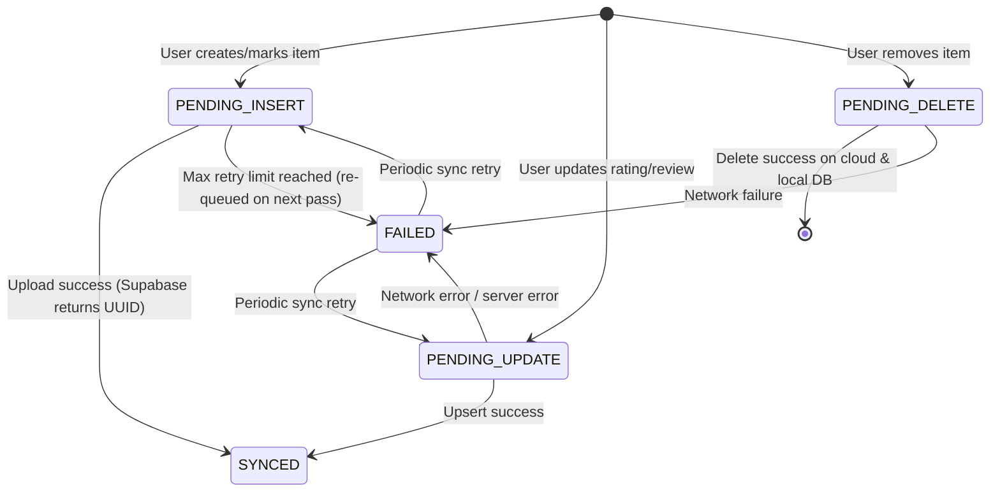
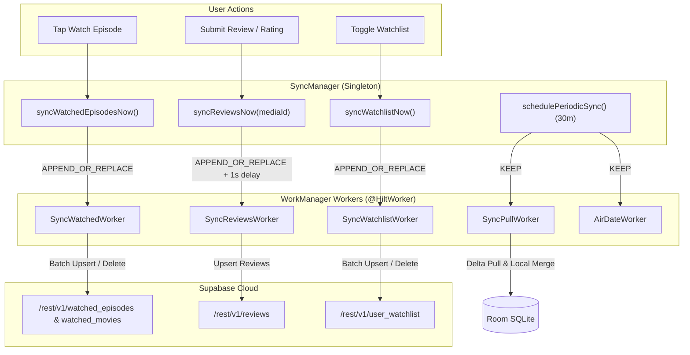
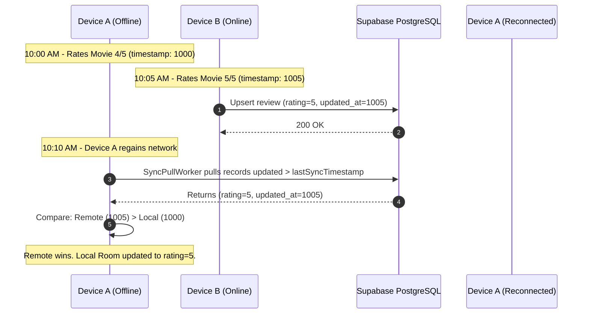

# Sequel — Pragmatic Offline-First Sync Engine

## 1. Executive Summary

Sequel's Synchronization Engine bridges the local **Room SQLite** single source of truth with the remote **Supabase PostgreSQL** cloud backend. It is designed to be **pragmatic, resilient, and non-blocking**:

- **Immediate Local Writes**: All user actions (toggling watched status, rating, reviews, watchlist changes) commit to Room synchronously with sub-10ms latency.
- **Asynchronous Cloud Sync**: Background synchronization is offloaded to Jetpack **WorkManager**, completely decoupled from UI lifecycles.
- **Eventual Consistency**: Changes are pushed to Supabase when connectivity is available. Missed updates are fetched during delta pull passes.
- **Rapid-Interaction Resilience**: Consecutive user taps (e.g., checking off 10 episodes in 5 seconds) are safely enqueued without aborting active network transmissions.

---

## 2. Sync State Machine

Every user-mutable entity in Room (`watched_episodes`, `watched_movies`, `reviews`, `watchlist`) contains a `sync_status` column managed by the `SyncStatus` enum:



### SyncStatus Definitions:
1. `SYNCED`: Record is completely synchronized with Supabase; `supabase_id` is populated.
2. `PENDING_INSERT`: New record created locally while offline or awaiting upload worker execution.
3. `PENDING_UPDATE`: Existing record modified locally (e.g. edited review text, altered rating).
4. `PENDING_DELETE`: Marked for remote deletion. Record is retained locally with this flag until Supabase confirms deletion, after which it is purged from Room.
5. `FAILED`: Encountered a transient or unrecoverable error during upload. Re-evaluated during full periodic sync.

---

## 3. WorkManager Orchestration Architecture



### 3.1 WorkManager Worker Catalog

| Worker | Responsibility | Trigger Triggered By | Constraints |
| ------ | -------------- | -------------------- | ----------- |
| `SyncWatchedWorker` | Pushes pending movie and episode watch statuses to Supabase | User toggle or periodic sync | `NetworkType.CONNECTED` |
| `SyncReviewsWorker` | Upserts ratings and text reviews; debounced by 1000ms | User rating change or review submit | `NetworkType.CONNECTED` |
| `SyncWatchlistWorker` | Pushes pending watchlist additions and removals | User watchlist button tap | `NetworkType.CONNECTED` |
| `SyncPullWorker` | Fetches delta changes from Supabase (other devices) and merges into Room | App launch & periodic (every 30m) | `NetworkType.CONNECTED` |
| `AirDateWorker` | Checks TMDB for newly aired episodes of tracked shows | Periodic (daily) | `NetworkType.CONNECTED` |

---

## 4. Rapid Interaction Resilience (The APPEND_OR_REPLACE Fix)

### The Problem with `ExistingWorkPolicy.REPLACE`
When a user checked off multiple episodes rapidly (e.g. 5 episodes within 2 seconds), an enqueue policy of `REPLACE` would violently cancel the active worker thread mid-HTTP request. This resulted in:
- Aborted network connections to Supabase.
- Repeated retry cascades.
- Wasted cellular data and battery life.
- Sluggish sync completion.

### The Solution: `ExistingWorkPolicy.APPEND_OR_REPLACE`
`SyncManager` utilizes `APPEND_OR_REPLACE`:
```kotlin
workManager.enqueueUniqueWork(
    SyncWatchedWorker.WORK_NAME + "_now",
    ExistingWorkPolicy.APPEND_OR_REPLACE,
    request
)
```
- If a worker is currently executing its upload loop, it is **permitted to finish uninterrupted**.
- The new request is queued immediately behind it, ensuring that any subsequent items marked during the first worker's execution are processed in the next batch.

---

## 5. Conflict Resolution: Last-Write-Wins (LWW)

When synchronizing data across multiple devices or reconciling local offline changes with remote cloud updates, Sequel uses a **Deterministic Last-Write-Wins (LWW)** strategy backed by millisecond timestamps:



### Conflict Rules by Entity Type:

1. **Watched Episodes & Movies**:
   - Primary key in Room: `(show_id, season_number, episode_number)` for episodes, `tmdb_movie_id` for movies.
   - Remote conflict target in Supabase: `(user_id, show_id, season_number, episode_number)` / `(user_id, tmdb_movie_id)`.
   - If both local and remote indicate "watched", the earlier `watched_at` timestamp is preserved (crediting the true initial viewing date).
   - If an item is marked "unwatched" on one device and "watched" on another, the event with the greater timestamp prevails.

2. **Reviews & Ratings**:
   - `updated_at` determines the winning record.
   - For movies, duplicate ghost records are eliminated at the database level using a partial unique index:
     ```sql
     CREATE UNIQUE INDEX idx_reviews_movie_unique 
     ON reviews (media_id, media_type) 
     WHERE season_num IS NULL AND episode_num IS NULL;
     ```

3. **Watchlist Items**:
   - Watchlist state is binary (in watchlist or removed).
   - Additions set `added_at = System.currentTimeMillis()`. If remote `added_at > local`, remote entry overwrites local cache.

---

## 6. Remote Delta Pull & Pagination

To ensure optimal performance and minimal memory consumption on mobile devices with libraries containing thousands of records, `SupabaseSyncService` implements range-based chunked streaming:

```kotlin
suspend fun fetchAllWatchlist(userId: String): List<SupabaseWatchlistDto> {
    val results = mutableListOf<SupabaseWatchlistDto>()
    var offset = 0L
    val limit = 1000L
    while (true) {
        val chunk = supabaseClient.postgrest[TABLE_WATCHLIST]
            .select {
                filter { eq("user_id", userId) }
                range(offset, offset + limit - 1)
            }.decodeList<SupabaseWatchlistDto>()
        results.addAll(chunk)
        if (chunk.size < limit) break
        offset += limit
    }
    return results
}
```

- Fetches data in chunks of 1,000 items.
- Avoids Android SQLite transaction payload overflow (`CursorWindowAllocationException`).
- Updates Room within an atomic database transaction (`db.withTransaction { ... }`) to prevent partial rendering states.

---

## 7. Retry Policies & Network Resilience

Every WorkManager request enqueued by `SyncManager` is configured with exponential backoff:

```kotlin
val request = OneTimeWorkRequestBuilder<SyncWatchedWorker>()
    .setConstraints(
        Constraints.Builder()
            .setRequiredNetworkType(NetworkType.CONNECTED)
            .build()
    )
    .setBackoffCriteria(
        BackoffPolicy.EXPONENTIAL,
        30, TimeUnit.SECONDS
    )
    .build()
```

- **Initial Retry Delay**: 30 seconds.
- **Backoff Growth**: 30s → 60s → 120s → 240s (capped at 5 hours).
- **Graceful Failure**: If Supabase responds with HTTP 503 (Maintenance) or HTTP 429 (Rate Limit), the worker returns `Result.retry()`.
- **Zero Data Loss**: Local records remain marked as `PENDING_*` indefinitely until acknowledged by the server.
